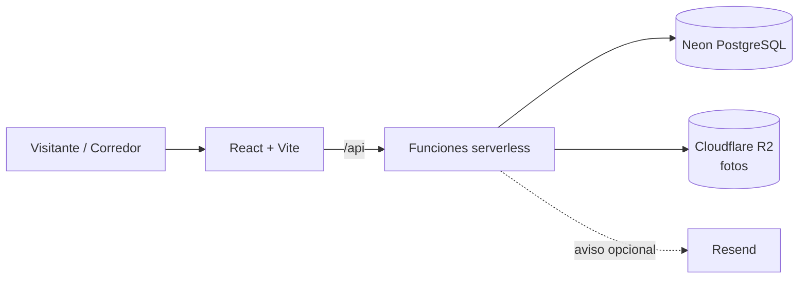

<div align="center">


# Geoñuble Propiedades

**Sitio web y gestor para una corredora de propiedades en la región de Ñuble, Chile.**


</div>

> [!IMPORTANT]
> **Proyecto en fase inicial.** Se está desarrollando la plataforma de una corredora de propiedades para la región de Ñuble: un sitio público para mostrar el catálogo y recibir consultas, con un **gestor incluido** (panel de administración y de corredores) para cargar propiedades, administrar usuarios, revisar mensajes y generar cotizaciones. Las funciones, la estructura de datos y el diseño pueden cambiar mientras avanza el desarrollo.

## Contenido

- [Funcionalidades](#funcionalidades)
- [Tecnología](#tecnología)
- [Arquitectura](#arquitectura)
- [Inicio rápido](#inicio-rápido)
- [Scripts](#scripts)
- [Variables de entorno](#variables-de-entorno)
- [Puesta en producción](#puesta-en-producción)
- [Estructura del proyecto](#estructura-del-proyecto)
- [Seguridad](#seguridad)

## Funcionalidades

### Sitio público

| Ruta | Descripción |
|---|---|
| `/` | Portada con buscador por operación y tipo de propiedad |
| `/propiedades` | Catálogo de propiedades publicadas |
| `/propiedades/:id` | Ficha con galería, características y mapa |
| `/contacto` | Formulario de contacto (con protección básica anti-bots) |

### Gestor (`/panel`)

| Módulo | Ruta | Rol |
|---|---|---|
| Propiedades | `/panel/propiedades` | Admin |
| Corredores y usuarios | `/panel/usuarios` | Admin |
| Mensajes | `/panel/mensajes` | Admin |
| Datos de la empresa | `/panel/empresa` | Admin |
| Cotizar | `/panel/cotizar` | Admin y corredor |
| Historial de cotizaciones | `/panel/cotizaciones` | Admin y corredor |
| Mi perfil | `/panel/perfil` | Admin y corredor |

- **Administrador**: carga propiedades (fotos, ubicación en el mapa, características), crea los usuarios de los corredores, revisa los mensajes del formulario y edita los datos de la empresa (teléfono, email, horarios…).
- **Corredor**: elige una propiedad, marca qué secciones incluir (foto, galería, precio, superficie, descripción, características, mapa, datos del corredor, vigencia) y descarga una **cotización en PDF** numerada. Cada corredor ve solo sus cotizaciones; el administrador ve todas.

## Tecnología

| Capa | Herramientas |
|---|---|
| Frontend | React 19, React Router 7, Vite |
| Backend | Funciones serverless de Vercel (`api/`) |
| Base de datos | Neon (PostgreSQL); PGlite en desarrollo local |
| Imágenes | Cloudflare R2, optimizadas en el navegador (máx. 1400 px y miniatura de 560 px) |
| Mapas y PDF | Leaflet + OpenStreetMap, jsPDF |
| Correo | Resend (opcional) |
| Sesiones | JWT firmado en cookie `HttpOnly`, contraseñas con bcrypt |

## Arquitectura



En desarrollo, Vite sirve las mismas funciones de `api/` y, si no hay credenciales, usa una base local (PGlite en `.data/`) y guarda las fotos en `public/uploads/`. No se necesita ninguna cuenta externa para trabajar en local.

## Inicio rápido

Requiere **Node.js 22.9 o superior**.

```bash
git clone https://github.com/machukeitor1/geonuble.git
cd geonuble
npm install
cp .env.example .env.local   # completa ADMIN_EMAIL y ADMIN_PASSWORD
npm run dev
```

Abre <http://localhost:5173/panel> e ingresa con `ADMIN_EMAIL` / `ADMIN_PASSWORD`. El administrador se crea automáticamente la primera vez.

Para empezar de cero en local, borra las carpetas `.data/` y `public/uploads/`.

## Scripts

| Comando | Descripción |
|---|---|
| `npm run dev` | Servidor de desarrollo con la API local |
| `npm run build` | Compila el sitio para producción en `dist/` |
| `npm run preview` | Sirve la compilación de producción |
| `npm run lint` | Revisa el código con ESLint |
| `npm test` | Tests de integración de la API |
| `npm run db:setup` | Crea las tablas y el administrador inicial en Neon |

Los tests cubren sesión, permisos por rol, propiedades, cotizaciones, contacto, datos de la empresa y fotos. Corren contra una base temporal, sin tocar `.data/` ni `public/uploads/`.

## Variables de entorno

Copia [`.env.example`](.env.example) a `.env.local`. **Nunca subas `.env.local` al repositorio** (ya está en `.gitignore`).

| Variable | Obligatoria en producción | Descripción |
|---|:---:|---|
| `DATABASE_URL` | Sí | Cadena de conexión de Neon. Sin ella, en local se usa PGlite |
| `JWT_SECRET` | Sí | Clave para firmar las sesiones (`openssl rand -base64 32`) |
| `ADMIN_EMAIL`, `ADMIN_PASSWORD`, `ADMIN_NAME` | Solo la primera vez | Administrador inicial |
| `R2_ACCOUNT_ID`, `R2_ACCESS_KEY_ID`, `R2_SECRET_ACCESS_KEY`, `R2_BUCKET` | Sí | Credenciales del bucket de fotos |
| `R2_PUBLIC_URL` | Sí | URL pública del bucket (`r2.dev` o dominio propio) |
| `RESEND_API_KEY` | No | Activa el aviso por correo de mensajes nuevos |
| `NOTIFY_EMAIL` | No | Destino del aviso; si falta, se usa el email de la empresa |
| `MAIL_FROM` | No | Remitente, requiere dominio verificado en Resend |

## Puesta en producción

<details>
<summary><strong>1. Neon (base de datos)</strong></summary>

1. Crea un proyecto en [neon.tech](https://neon.tech) (región São Paulo o la más cercana).
2. Copia la cadena de conexión (**Connect** → `postgresql://...`) en `DATABASE_URL` de tu `.env.local`.
3. Completa `ADMIN_EMAIL`, `ADMIN_PASSWORD` y `ADMIN_NAME`, y crea las tablas y el administrador:

   ```bash
   npm run db:setup
   ```

</details>

<details>
<summary><strong>2. Cloudflare R2 (fotos)</strong></summary>

1. En Cloudflare → **R2** → crea un bucket (ej. `geonuble-fotos`).
2. En el bucket → **Settings** → **Public access**: activa la URL `r2.dev` o conecta un dominio propio (recomendado para producción). Esa URL va en `R2_PUBLIC_URL`.
3. En el bucket → **Settings** → **CORS policy**, pega esto (necesario para que las fotos entren al PDF):

   ```json
   [{ "AllowedOrigins": ["https://TU-DOMINIO.cl", "http://localhost:5173"], "AllowedMethods": ["GET"], "AllowedHeaders": ["*"] }]
   ```

4. R2 → **Manage API tokens** → crea un token con permiso *Object Read & Write* para ese bucket. Copia `Access Key ID`, `Secret Access Key` y tu `Account ID`.

</details>

<details>
<summary><strong>3. Vercel</strong></summary>

1. Importa el repositorio en [vercel.com](https://vercel.com) (detecta Vite automáticamente).
2. En **Settings → Environment Variables** agrega las variables de la tabla anterior.
3. Despliega. Entra a `/panel`, completa **Datos de la empresa** y crea los usuarios de los corredores en **Corredores y usuarios**.

> [!NOTE]
> El plan gratuito *Hobby* de Vercel es para uso no comercial. Para un sitio de empresa corresponde el plan Pro, o publicar en otro hosting que soporte funciones Node.

</details>

<details>
<summary><strong>4. Aviso por correo de mensajes nuevos (opcional)</strong></summary>

Cada mensaje del formulario de contacto se guarda en el panel y, además, puede llegar por correo:

1. Crea una cuenta gratis en [resend.com](https://resend.com) (3.000 correos/mes) con el correo donde quieres recibir los avisos.
2. **API Keys → Create API Key** (permiso *Sending access*).
3. En `.env.local` y en Vercel agrega `RESEND_API_KEY` y `NOTIFY_EMAIL` (el mismo correo de tu cuenta de Resend) y vuelve a desplegar.

Sin dominio verificado, Resend envía desde `onboarding@resend.dev` y **solo al correo de tu cuenta**. Para enviar a otras direcciones o desde `avisos@tu-dominio.cl`, verifica el dominio en Resend y define `MAIL_FROM`. Con el dominio verificado, `NOTIFY_EMAIL` acepta varios correos separados por coma.

Mientras no tengas dominio, puedes reenviar los avisos con un filtro de Gmail (De: `onboarding@resend.dev` → Reenviar a). Si el envío falla, el mensaje igual queda guardado en **Panel → Mensajes**.

</details>

### Límites gratuitos (referencia)

| Servicio | Gratis | Uso aproximado |
|---|---|---|
| Cloudflare R2 | 10 GB guardados, salida de datos sin costo | ~2 MB por propiedad con 8 fotos → miles de propiedades |
| Neon | 0,5 GB por proyecto | Suficiente para propiedades, usuarios y cotizaciones |

## Estructura del proyecto

```
api/            funciones serverless (auth, properties, users, upload, quotes, contact, settings)
lib/            código compartido del backend (db, auth, storage, schema, mail)
scripts/        db-setup.js
tests/          tests de integración de la API
src/
  pages/        sitio público
  panel/        gestor de admin y corredores (se carga por separado)
  components/   Navbar, Footer, PropertyCard, MapView, Slideshow
  lib/          cliente API, formato, imágenes, PDF de cotización, mapa estático
  context/      sesión y datos de la empresa
public/         logo e imágenes de portada
```

## Seguridad

- Las contraseñas se guardan con **bcrypt** y la sesión va en una cookie `HttpOnly` (`Secure` en producción).
- Cada endpoint del gestor valida el rol en el servidor (admin o corredor), no solo en la interfaz.
- **Define siempre `JWT_SECRET` en producción.** En Vercel, sin ella el inicio de sesión responde con error; en otro hosting se usaría una clave de desarrollo conocida, así que es obligatorio configurarla.

## Licencia

Aún no se ha definido una licencia para este proyecto.
