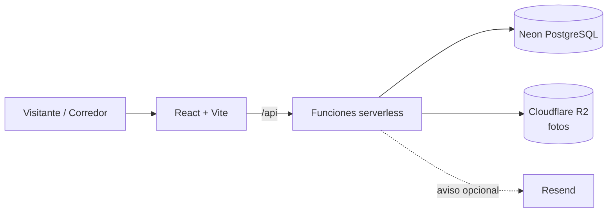
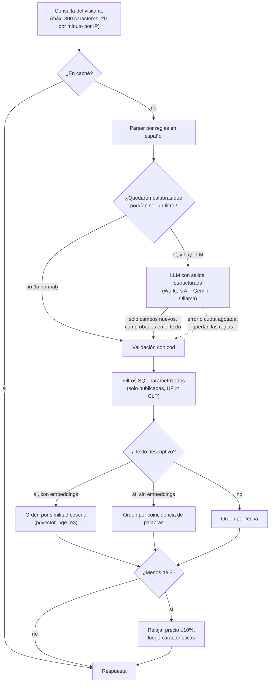

<div align="center">


# Geoñuble Propiedades

**Sitio web y gestor para una corredora de propiedades en la región de Ñuble, Chile.**


</div>

> [!IMPORTANT]
> **Proyecto en fase inicial.** Se está desarrollando la plataforma de una corredora de propiedades para la región de Ñuble: un sitio público para mostrar el catálogo y recibir consultas, con un **gestor incluido** (panel de administración y de corredores) para cargar propiedades, administrar usuarios, revisar mensajes y generar cotizaciones. Las funciones, la estructura de datos y el diseño pueden cambiar mientras avanza el desarrollo.

## Contenido

- [Funcionalidades](#funcionalidades)
- [Tecnología](#tecnología)
- [Arquitectura](#arquitectura)
- [Búsqueda con IA](#búsqueda-con-ia)
- [Inicio rápido](#inicio-rápido)
- [Scripts](#scripts)
- [Variables de entorno](#variables-de-entorno)
- [Puesta en producción](#puesta-en-producción)
- [Estructura del proyecto](#estructura-del-proyecto)
- [Seguridad](#seguridad)

## Funcionalidades

### Sitio público

| Ruta | Descripción |
|---|---|
| `/` | Portada con buscador por operación y tipo, y campo "Busca con tus palabras" |
| `/buscar` | [Búsqueda con IA](#búsqueda-con-ia): resultados y filtros entendidos como chips editables |
| `/propiedades` | Catálogo de propiedades publicadas |
| `/propiedades/:id` | Ficha con galería, características y mapa |
| `/contacto` | Formulario de contacto (con protección básica anti-bots) |

### Gestor (`/panel`)

| Módulo | Ruta | Rol |
|---|---|---|
| Propiedades | `/panel/propiedades` | Admin |
| Corredores y usuarios | `/panel/usuarios` | Admin |
| Mensajes | `/panel/mensajes` | Admin |
| Datos de la empresa | `/panel/empresa` | Admin |
| Cotizar | `/panel/cotizar` | Admin y corredor |
| Historial de cotizaciones | `/panel/cotizaciones` | Admin y corredor |
| Mi perfil | `/panel/perfil` | Admin y corredor |

- **Administrador**: carga propiedades (fotos, ubicación en el mapa, características), crea los usuarios de los corredores, revisa los mensajes del formulario y edita los datos de la empresa (teléfono, email, horarios…).
- **Corredor**: elige una propiedad, marca qué secciones incluir (foto, galería, precio, superficie, descripción, características, mapa, datos del corredor, vigencia) y descarga una **cotización en PDF** numerada. Cada corredor ve solo sus cotizaciones; el administrador ve todas.

## Tecnología

| Capa | Herramientas |
|---|---|
| Frontend | React 19, React Router 7, Vite |
| Backend | Funciones serverless de Vercel (`api/`) |
| Base de datos | Neon (PostgreSQL); PGlite en desarrollo local |
| Imágenes | Cloudflare R2, optimizadas en el navegador (máx. 1400 px y miniatura de 560 px) |
| Mapas y PDF | Leaflet + OpenStreetMap, jsPDF |
| Correo | Resend (opcional) |
| Búsqueda con IA | pgvector, Cloudflare Workers AI / Gemini / Ollama, zod (opcional, plan gratis) |
| Sesiones | JWT firmado en cookie `HttpOnly`, contraseñas con bcrypt |

## Arquitectura



En desarrollo, Vite sirve las mismas funciones de `api/` y, si no hay credenciales, usa una base local (PGlite en `.data/`) y guarda las fotos en `public/uploads/`. No se necesita ninguna cuenta externa para trabajar en local.

## Búsqueda con IA

El visitante escribe lo que busca con sus palabras, por ejemplo *"casa de 3 dormitorios en Chillán con patio, hasta 120 millones"*, y en `/buscar` ve las propiedades que mejor calzan junto con **los filtros que entendió el sistema**. Esos filtros aparecen como chips que se pueden editar o quitar; al cambiarlos se busca de nuevo **sin volver a llamar al modelo**.



### Por qué es híbrida

- **SQL para lo exacto.** Comuna, tipo, operación, dormitorios, baños, superficie y precio son condiciones duras: quien pide 3 dormitorios no quiere ver un monoambiente porque "se parece". Se filtran con consultas parametrizadas, sin concatenar nunca texto del usuario.
- **Vectores para lo descriptivo.** "Luminosa", "tranquila" o "cerca del centro" no son columnas. Ese resto de la consulta (`texto_semantico`) se convierte en un embedding y ordena los resultados por similitud con el título, la descripción y las características de cada propiedad.
- **Reglas primero, LLM como complemento.** Las reglas entienden casi todo en 1 ms. El LLM solo se consulta cuando quedan palabras que podrían ser un filtro y las reglas no conocen ("condominio", "frutales", "sauna"); las palabras descriptivas ("luminosa", "cerca del colegio") van directo a los embeddings. De su respuesta solo se aceptan campos que las reglas no encontraron y que se pueden comprobar en el texto: una comuna solo si está escrita, un número solo si la consulta tiene números, una característica solo si aparece en la consulta. La operación nunca viene del LLM. Así el modelo puede agregar, pero no empeorar lo que las reglas ya hicieron bien.
- **El LLM solo traduce.** No decide qué propiedades existen ni las inventa: convierte el texto en un JSON con un esquema cerrado (tipos y comunas del catálogo), que se valida con zod antes de tocar la base.

### Proveedores (todos con plan gratis)

| Pieza | Variable | Opciones | Por defecto |
|---|---|---|---|
| Extracción de filtros | `LLM_PROVIDER` | `workers-ai`, `gemini`, `ollama` | `@cf/meta/llama-3.1-8b-instruct` · `gemini-3.5-flash-lite` · `llama3.1:8b` |
| Uso del LLM | `LLM_MODE` | `complemento` (reglas primero) o `principal` (el LLM interpreta todo) | `complemento` |
| Embeddings | `EMBEDDINGS_PROVIDER` | `workers-ai`, `ollama` | `@cf/baai/bge-m3` (multilingüe, 1024 dimensiones) |
| Valor de la UF | `CMF_API_KEY` | CMF (oficial) o mindicador.cl (sin clave) | mindicador.cl, guardado 12 h en `settings` |
| Plan B | — | Parser por reglas en español | Siempre disponible |

Sin ninguna variable configurada la búsqueda **funciona igual** con el parser por reglas (orden por palabras en vez de similitud).

- **Privacidad:** al LLM solo viaja el texto de búsqueda; nunca datos de clientes ni de corredores. A los embeddings va el texto público del aviso. En el plan gratis de Gemini, Google usa el contenido enviado para mejorar sus productos.
- **Embeddings eficientes:** se calculan al guardar una propiedad en el gestor junto con un hash del texto; si el título, la descripción o las características no cambian, **no se recalculan**. Los de consultas repetidas quedan en caché.

### Resultados del eval

`tests/search-evals.json` tiene **30 consultas realistas de Ñuble** con los filtros esperados y las propiedades que deberían salir entre las 5 primeras, sobre 21 propiedades ficticias (`tests/fixtures/properties.json`). `npm run eval:search` las corre en una base temporal con la UF fija y compara el parser por reglas con el LLM configurado:

| Métrica | Reglas | Híbrido 8B | Híbrido 70B | LLM principal 8B | LLM principal 70B |
|---|---:|---:|---:|---:|---:|
| Filtros correctos (todos los campos) | **100%** | 98,9% | **100%** | 79,2% | 95,5% |
| Consultas con todos los filtros correctos | **100%** | 96,7% | **100%** | 50,0% | 90,0% |
| Características correctas | **100%** | 91,7% | **100%** | 57,1% | 84,6% |
| Recall@5 | **96,6%** | **96,6%** | **96,6%** | 94,0% | **96,6%** |
| Consultas que llaman al LLM | 0 de 30 | 3 de 30 | 3 de 30 | 30 de 30 | 30 de 30 |
| Latencia de interpretación (prom. / p95) | **1 ms / 2 ms** | 76 ms / 895 ms | 143 ms / 1.567 ms | 517 ms / 913 ms | 2.108 ms / 4.021 ms |
| Latencia total de la búsqueda (prom.) | **~85 ms** | 181 ms | 244 ms | 596 ms | 2.175 ms |
| Búsquedas diarias con la cuota gratis | ilimitadas | ~18.500 | ~3.200 | ~2.000 | ~310 |

Medido el 25-11-2026 en Workers AI (`@cf/meta/llama-3.1-8b-instruct` y `@cf/meta/llama-3.3-70b-instruct-fp8-fast`), con embeddings bge-m3 en todas las columnas. Costo en dinero: $0 en todos los casos (plan gratis). Los modos se comparan con `npm run eval:search -- --modos=reglas,llm,hibrido`.

**Qué muestra:** el modo híbrido se queda con lo mejor de cada parte. Las reglas resuelven 27 de las 30 consultas sin llamar a nadie, y el LLM solo entra en las 3 con palabras que las reglas no conocen ("cabaña", "camiones" y un intento de inyección), donde puede agregar lo que falta sin tocar lo demás. En esas 3 llamadas, el 70B no agregó nada incorrecto y el 8B sí agregó una característica que la consulta no pedía. El único error de recall ("busco algo tranquilo en el campo, con pozo") viene de las reglas, que leen "campo" como tipo; el híbrido no lo corrige porque nunca reemplaza lo que entendieron las reglas.

**Configuración en producción:** reglas + embeddings + LLM como complemento con el 70B (`LLM_PROVIDER=workers-ai`, `LLM_MODEL=@cf/meta/llama-3.3-70b-instruct-fp8-fast`, `LLM_MODE` sin definir). Es el más confiable justo en los casos donde se usa, y la cuota alcanza para ~3.200 búsquedas diarias. Ejemplos reales en producción: "parcela con frutales y sauna" y "cabaña para vacaciones" se resolvieron como **Reglas + IA**.

**Cuidado con el 100%:** este set lo escribió el mismo autor de las reglas, de la lista de palabras descriptivas y del vocabulario de características, y parte de ese vocabulario ("condominio", "frutal") se agregó después de ver los errores del eval. El resultado de las reglas es, por lo tanto, optimista. Lo que confirma o desmiente el diseño son consultas reales de visitantes.

**El prompt importó tanto como el modelo.** Con la primera versión, los dos modelos copiaban en `texto_semantico` el ejemplo del propio prompt, agregaban `operacion: "venta"` sin que la consulta lo dijera e inventaban comunas. La segunda versión exige que `operacion` y `comuna` aparezcan escritas en la consulta, prohíbe agregar palabras que la consulta no dice y trae dos ejemplos que no se parecen al set de evaluación. Resultado:

| | Filtros correctos | Consultas exactas | Recall@5 | Respuestas inválidas |
|---|---:|---:|---:|---:|
| 8B, primer prompt → prompt actual | 55,8% → 79,2% | 13,3% → 50,0% | 73,3% → 94,0% | 7 → 0 |
| 70B, primer prompt → prompt actual | 87,1% → 95,5% | 70,0% → 90,0% | 92,2% → 96,6% | 1 → 0 |

**En modo principal**, sin reglas delante, el 70B queda cerca de las reglas pero tarda ~2 s por búsqueda; sus errores fueron dejar un precio dentro de `texto_semantico` y traducir "para camiones" como "estacionamiento". El 8B convierte frases en características ("vista a la cordillera", "grande") y confunde tipos ("3d2b" → Departamento).

**Ojo con el sesgo:** las consultas las escribió el mismo autor del parser, así que el resultado de las reglas es optimista; lo que más importa es comparar con consultas reales de visitantes. Los errores del parser están en características que no conoce ("condominio", "frutales") y en consultas vagas ("algo tranquilo en el campo").

### Costo y cuota

- **Workers AI:** 10.000 neurons gratis al día (se reinician a las 00:00 UTC). Con los precios publicados de `llama-3.1-8b-instruct-fp8-fast` como referencia (4.119 neurons por millón de tokens de entrada y 34.868 de salida), una extracción de ~700 tokens de entrada y ~40 de salida usa ≈4 neurons, y el embedding de la consulta (bge-m3, 1.075 neurons por millón) es despreciable: **del orden de 2.000 búsquedas diarias gratis** si el LLM interpreta todo. En modo complemento solo ~1 de cada 10 búsquedas del set llama al LLM: ~18.500 diarias con el 8B o ~3.200 con el 70B. El eval imprime el valor medido.
- **Gemini Flash-Lite:** gratis dentro de los límites del plan (por proyecto; se reinician a medianoche hora del Pacífico).
- **Ollama:** local, sin costo; útil para correr los evals.
- Si se agota la cuota (o ante cualquier error del proveedor), la búsqueda sigue con el parser por reglas y lo avisa en la respuesta.

### Configuración

1. **Cloudflare Workers AI:** en el panel de Cloudflare copia tu *Account ID* y crea un token en **My Profile → API Tokens** con el permiso **Workers AI** (solo ese). Define `CF_ACCOUNT_ID`, `CF_AI_TOKEN` y `EMBEDDINGS_PROVIDER=workers-ai`. Para el complemento con IA agrega `LLM_PROVIDER=workers-ai` y `LLM_MODEL=@cf/meta/llama-3.3-70b-instruct-fp8-fast` (`LLM_MODE` queda en `complemento` por defecto).
2. **Base de datos:** `npm run db:setup` activa `pgvector` en Neon y agrega las columnas `embedding` y `embedding_hash` (se puede correr de nuevo sin riesgo). Luego `npm run embed:backfill` genera los embeddings de las propiedades existentes.
3. **En local:** `npm run seed:demo` carga las propiedades ficticias en `.data/` para probar `/buscar`. Si vienes de una versión anterior, borra `.data/` (PGlite 0.6 no abre bases creadas con 0.5).
4. **Evals sin gastar cuota:** con [Ollama](https://ollama.com) instalado, `ollama pull llama3.1:8b` y `ollama pull bge-m3`, define `LLM_PROVIDER=ollama` y `EMBEDDINGS_PROVIDER=ollama`, y corre `npm run eval:search -- --detalle`.

5. **Comprobar que el LLM responde:** cada respuesta de `POST /api/search` trae el campo `ia`: `desactivada` (falta `LLM_PROVIDER`), `no_necesaria` (las reglas entendieron todo), `aporto`, `sin_aporte` o `fallo:<motivo>` (`cuota`, `error`, `respuesta_invalida`, `sin_configuracion`). Una consulta como "casa en condominio" debería dar `aporto`.

### Límites conocidos

- El caché de respuestas y el rate limit viven en memoria: en Vercel valen por instancia, no globalmente.
- La integración con Gemini sigue la documentación de la Interactions API, pero no se ha probado con una clave real.
- Cambiar `EMBEDDINGS_DIM` exige borrar la columna `embedding` y volver a generar los embeddings.

## Inicio rápido

Requiere **Node.js 22.9 o superior**.

```bash
git clone https://github.com/machukeitor1/geonuble.git
cd geonuble
npm install
cp .env.example .env.local   # completa ADMIN_EMAIL y ADMIN_PASSWORD
npm run dev
```

Abre <http://localhost:5173/panel> e ingresa con `ADMIN_EMAIL` / `ADMIN_PASSWORD`. El administrador se crea automáticamente la primera vez.

Para empezar de cero en local, borra las carpetas `.data/` y `public/uploads/`.

## Scripts

| Comando | Descripción |
|---|---|
| `npm run dev` | Servidor de desarrollo con la API local |
| `npm run build` | Compila el sitio para producción en `dist/` |
| `npm run preview` | Sirve la compilación de producción |
| `npm run lint` | Revisa el código con ESLint |
| `npm test` | Tests de la API, la búsqueda y el parser (sin gastar API) |
| `npm run db:setup` | Crea las tablas (con pgvector) y el administrador inicial en Neon |
| `npm run embed:backfill` | Genera los embeddings que faltan o cambiaron |
| `npm run seed:demo` | Carga propiedades ficticias en la base local |
| `npm run eval:search` | Evalúa la búsqueda: reglas vs. LLM (`-- --detalle` para ver errores) |

Los tests cubren sesión, permisos por rol, propiedades, cotizaciones, contacto, datos de la empresa, fotos y la búsqueda con IA (con el LLM y los embeddings simulados). Corren contra una base temporal, sin tocar `.data/` ni `public/uploads/`.

## Variables de entorno

Copia [`.env.example`](.env.example) a `.env.local`. **Nunca subas `.env.local` al repositorio** (ya está en `.gitignore`).

| Variable | Obligatoria en producción | Descripción |
|---|:---:|---|
| `DATABASE_URL` | Sí | Cadena de conexión de Neon. Sin ella, en local se usa PGlite |
| `JWT_SECRET` | Sí | Clave para firmar las sesiones (`openssl rand -base64 32`) |
| `ADMIN_EMAIL`, `ADMIN_PASSWORD`, `ADMIN_NAME` | Solo la primera vez | Administrador inicial |
| `R2_ACCOUNT_ID`, `R2_ACCESS_KEY_ID`, `R2_SECRET_ACCESS_KEY`, `R2_BUCKET` | Sí | Credenciales del bucket de fotos |
| `R2_PUBLIC_URL` | Sí | URL pública del bucket (`r2.dev` o dominio propio) |
| `RESEND_API_KEY` | No | Activa el aviso por correo de mensajes nuevos |
| `NOTIFY_EMAIL` | No | Destino del aviso; si falta, se usa el email de la empresa |
| `MAIL_FROM` | No | Remitente, requiere dominio verificado en Resend |
| `LLM_PROVIDER`, `LLM_MODEL` | No | Modelo que extrae los filtros de la búsqueda con IA |
| `LLM_MODE` | No | `complemento` (por defecto: reglas primero) o `principal` |
| `CF_ACCOUNT_ID`, `CF_AI_TOKEN` | No | Cloudflare Workers AI (token solo con permiso de Workers AI) |
| `GEMINI_API_KEY` | No | Si `LLM_PROVIDER=gemini` |
| `EMBEDDINGS_PROVIDER`, `EMBEDDINGS_MODEL`, `EMBEDDINGS_DIM` | No | Embeddings para ordenar por similitud (bge-m3, 1024) |
| `OLLAMA_URL` | No | Ollama local para los evals |
| `CMF_API_KEY`, `UF_CLP` | No | Fuente oficial de la UF y valor de respaldo |

## Puesta en producción

<details>
<summary><strong>1. Neon (base de datos)</strong></summary>

1. Crea un proyecto en [neon.tech](https://neon.tech) (región São Paulo o la más cercana).
2. Copia la cadena de conexión (**Connect** → `postgresql://...`) en `DATABASE_URL` de tu `.env.local`.
3. Completa `ADMIN_EMAIL`, `ADMIN_PASSWORD` y `ADMIN_NAME`, y crea las tablas y el administrador:

   ```bash
   npm run db:setup
   ```

</details>

<details>
<summary><strong>2. Cloudflare R2 (fotos)</strong></summary>

1. En Cloudflare → **R2** → crea un bucket (ej. `geonuble-fotos`).
2. En el bucket → **Settings** → **Public access**: activa la URL `r2.dev` o conecta un dominio propio (recomendado para producción). Esa URL va en `R2_PUBLIC_URL`.
3. En el bucket → **Settings** → **CORS policy**, pega esto (necesario para que las fotos entren al PDF):

   ```json
   [{ "AllowedOrigins": ["https://TU-DOMINIO.cl", "http://localhost:5173"], "AllowedMethods": ["GET"], "AllowedHeaders": ["*"] }]
   ```

4. R2 → **Manage API tokens** → crea un token con permiso *Object Read & Write* para ese bucket. Copia `Access Key ID`, `Secret Access Key` y tu `Account ID`.

</details>

<details>
<summary><strong>3. Vercel</strong></summary>

1. Importa el repositorio en [vercel.com](https://vercel.com) (detecta Vite automáticamente).
2. En **Settings → Environment Variables** agrega las variables de la tabla anterior.
3. Despliega. Entra a `/panel`, completa **Datos de la empresa** y crea los usuarios de los corredores en **Corredores y usuarios**.

> [!NOTE]
> El plan gratuito *Hobby* de Vercel es para uso no comercial. Para un sitio de empresa corresponde el plan Pro, o publicar en otro hosting que soporte funciones Node.

</details>

<details>
<summary><strong>4. Aviso por correo de mensajes nuevos (opcional)</strong></summary>

Cada mensaje del formulario de contacto se guarda en el panel y, además, puede llegar por correo:

1. Crea una cuenta gratis en [resend.com](https://resend.com) (3.000 correos/mes) con el correo donde quieres recibir los avisos.
2. **API Keys → Create API Key** (permiso *Sending access*).
3. En `.env.local` y en Vercel agrega `RESEND_API_KEY` y `NOTIFY_EMAIL` (el mismo correo de tu cuenta de Resend) y vuelve a desplegar.

Sin dominio verificado, Resend envía desde `onboarding@resend.dev` y **solo al correo de tu cuenta**. Para enviar a otras direcciones o desde `avisos@tu-dominio.cl`, verifica el dominio en Resend y define `MAIL_FROM`. Con el dominio verificado, `NOTIFY_EMAIL` acepta varios correos separados por coma.

Mientras no tengas dominio, puedes reenviar los avisos con un filtro de Gmail (De: `onboarding@resend.dev` → Reenviar a). Si el envío falla, el mensaje igual queda guardado en **Panel → Mensajes**.

</details>

### Límites gratuitos (referencia)

| Servicio | Gratis | Uso aproximado |
|---|---|---|
| Cloudflare R2 | 10 GB guardados, salida de datos sin costo | ~2 MB por propiedad con 8 fotos → miles de propiedades |
| Neon | 0,5 GB por proyecto | Suficiente para propiedades, usuarios y cotizaciones |

## Estructura del proyecto

```
api/            funciones serverless (auth, properties, users, upload, quotes, contact, settings, search)
lib/            código compartido del backend (db, auth, storage, schema, mail, uf)
  search/       búsqueda con IA: filtros, reglas, proveedores, embeddings y consulta híbrida
scripts/        db-setup, embed-backfill, seed-demo y eval-search
tests/          tests de la API y de la búsqueda, fixtures y set de evaluación
src/
  pages/        sitio público
  panel/        gestor de admin y corredores (se carga por separado)
  components/   Navbar, Footer, PropertyCard, MapView, Slideshow
  lib/          cliente API, formato, imágenes, PDF de cotización, mapa estático
  context/      sesión y datos de la empresa
public/         logo e imágenes de portada
```

## Seguridad

- Las contraseñas se guardan con **bcrypt** y la sesión va en una cookie `HttpOnly` (`Secure` en producción).
- Cada endpoint del gestor valida el rol en el servidor (admin o corredor), no solo en la interfaz.
- **Define siempre `JWT_SECRET` en producción.** En Vercel, sin ella el inicio de sesión responde con error; en otro hosting se usaría una clave de desarrollo conocida, así que es obligatorio configurarla.

## Licencia

Aún no se ha definido una licencia para este proyecto.
